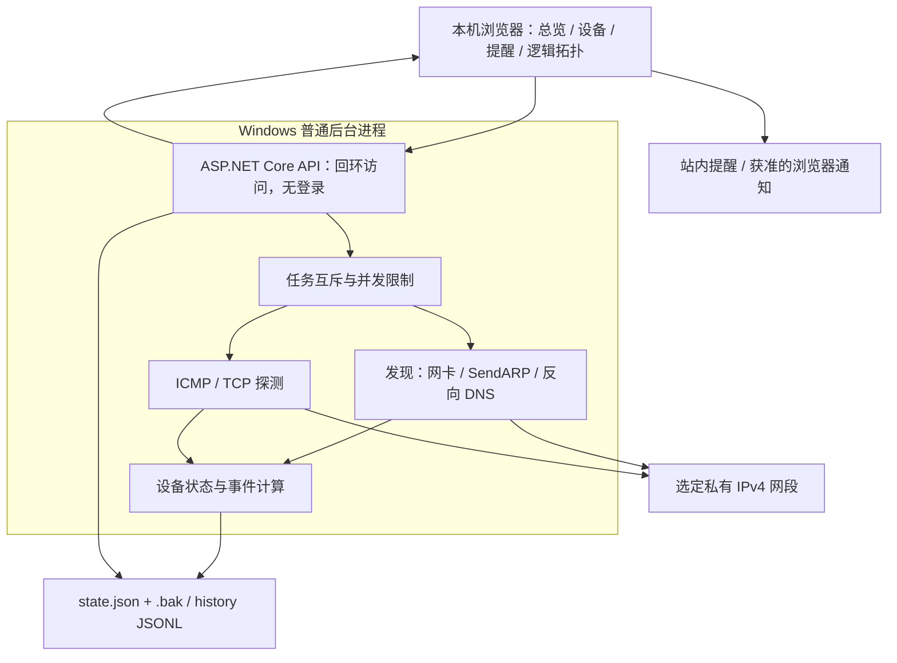

# 局域网监控与设备管理系统：GitHub 调研与 Windows 首版方案

调研及更新日期：2026-11-02。

用户已确认：Windows 办公电脑部署、本机浏览器访问、不使用数据库。本文保留此前官方资料调研，并按当前源码更新实现范围。本次文档修订只读审查源码，未执行构建、启动、网络扫描或测试；运行结果由主任务交付记录提供。

## 1. 当前方案

LANtern 首版采用 **C# / ASP.NET Core 8 + React / TypeScript + 本地 JSON 文件**。API 和后台采集任务运行在一个 Windows 普通后台进程中，未注册 SCM Windows Service。`state.json` 保存设置、台账和事件，原子替换时保留 `.bak`；采样历史按日追加 JSONL。无需 SQLite 或其他数据库。

当前固定监听 `127.0.0.1:5188`，无账户登录；页面通过本机浏览器访问。代码限制最多 500 台设备，20–500 台仍是产品目标范围，未进行负载验证。设备发现只覆盖配置的私有 IPv4 网段，物理拓扑、远程访问和外部通知列为后续增强。

## 2. GitHub 项目对比

下表上游能力来自此前读取的官方仓库和文档；借鉴点和部署判断属于本项目设计判断。未按星数排序，也未审计所有源码或依赖。本次没有重新联网核验。

| 项目 | 官方确认的能力 | 本项目借鉴点与 Windows 判断 | 观察到的许可证 |
|---|---|---|---|
| [NetAlertX](https://github.com/netalertx/NetAlertX) | 多来源发现，arp-scan、DHCP/设备平台等插件，状态变化、分布式采集 | 学习观测合并和插件边界；官方容器 host 网络能力不能等同 Windows 原生支持 | GPL-3.0 |
| [WatchYourLAN](https://github.com/aceberg/WatchYourLAN) | 轻量 IP 扫描、新设备提醒、在线/离线历史、设备清单 | 学习小型局域网的发现与台账；其 Linux arp-scan 不是本项目依赖 | MIT |
| [Uptime Kuma](https://github.com/louislam/uptime-kuma) | Ping、TCP、HTTP 监控，图表和多渠道通知；Windows 非容器安装路径 | 学习监控与异常界面；自动发现、资产和拓扑需要独立实现 | MIT |
| [LibreNMS](https://github.com/librenms/librenms) | SNMP/ARP/xDP 自动发现、网络地图、接口信息与告警 | 学习网管采集和关系来源；完整栈偏 Linux，仅作网管增强参考 | GPLv3，含第三方例外 |
| [Netdisco](https://github.com/netdisco/netdisco) | 经 SNMP/CLI/API 收集 IP/MAC、定位交换机端口，资产存于 PostgreSQL | 学习 MAC/IP/VLAN/端口关联；其完整栈不作为本项目安装依赖 | BSD-3-Clause |
| [Zabbix](https://github.com/zabbix/zabbix) | ICMP 可达性、丢包率、时延、发现动作、模板与触发器 | 学习连续失败与恢复规则；其网络发现不提供自动拓扑发现 | 观察的 master 为 AGPLv3 |

证据入口：[设备发现研究](../notes/discovery-research.md)、[拓扑与监控研究](../notes/topology-research.md)。许可证为当时页面声明；若引入上游代码，须固定提交/版本并核对对应 LICENSE 和第三方声明。

建议阅读顺序：WatchYourLAN README → NetAlertX 发现插件 → Uptime Kuma 监控/通知 → Zabbix [ICMP Ping 模板](https://www.zabbix.com/integrations/ping) → LibreNMS [自动发现](https://docs.librenms.org/Extensions/Auto-Discovery/)与[网络地图](https://docs.librenms.org/Extensions/Network-Map/) → Netdisco [配置文档](https://github.com/netdisco/netdisco/wiki/Configuration)。

## 3. 当前架构与证据

| 组件 | 当前代码 | 实现边界 |
|---|---|---|
| 程序与 API | [Program.cs](../src/Lantern/Program.cs)、[启动脚本](../scripts/start.ps1) | 固定回环；允许 localhost/127.0.0.1 Host，写 API 检查会话令牌与同源 Origin；无登录、SCM 服务或远程共享 |
| 采集与调度 | [NetworkProbe.cs](../src/Lantern/NetworkProbe.cs)、[MonitorService.cs](../src/Lantern/MonitorService.cs) | 原生 Ping/TCP/SendARP，无 Npcap 或外部扫描器；SNMP 尚未实现 |
| 存储 | [FileStateStore.cs](../src/Lantern/FileStateStore.cs) | JSON 原子状态替换与 JSONL 历史；无数据库、无跨文件事务 |
| 界面与通知 | [App.tsx](../frontend/src/App.tsx)、[pages.tsx](../frontend/src/pages.tsx) | 站内事件与需授权、需页面运行的浏览器通知；无邮件/Webhook/投递队列 |

构建脚本先构建前端至 `src/Lantern/wwwroot`，再发布 .NET 应用至 `artifacts/app`，为依赖本机运行时的发布。启动脚本隐藏启动并记录日志/PID，默认令 `LAN_DATA_DIR` 为仓库下的绝对 data 目录。直接运行 DLL 未设置此变量时使用应用目录下的 data。详细运行说明见 [Windows 启动说明](../notes/windows-run.md)。

此前核实的 [Microsoft Windows Service 托管文档](https://learn.microsoft.com/en-us/aspnet/core/host-and-deploy/windows-service?view=aspnetcore-10.0)与 [SQLite WAL 文档](https://sqlite.org/wal.html)保留为研究资料，均不表示当前已采用。详见[平台证据与当前选择](../notes/windows-platform-evidence.md)。

## 4. 六项需求的实现范围

### 自动发现

枚举网卡 IPv4、子网、网关与 MAC，为用户提供候选网段。发现允许单个私有 IPv4 CIDR `/22`–`/32`、最多 1024 目标，组合 ICMP、指定 TCP 和 Windows 同链路 `SendARP`；对可达设备尝试反向 DNS。支持发现进度与取消，保存网段并开启自动发现后默认每 10 分钟发现一次。

当前没有排除地址列表、mDNS、厂商识别、IPv6 或分布式采集器。历史邻居缓存不作为存活清单。跨路由 IP 可达不代表可取得远端 MAC；Wi-Fi 隔离、VPN、静默设备与多网卡行为需现场验证。

### IP、MAC、名称与状态

设备有持久化 UUID、IP/MAC/hostname、首次/末次发现、最后采集、最近结果与最多 50 次地址变化。可编辑别名、类型、分组、备注、监测开关和 TCP 端口；当前没有位置、负责人或独立网卡实体。

同网段 MAC 辅助识别地址变化；同 MAC 同时出现于不同 IP 时产生身份提醒，IP 被新 MAC 占用时暂停旧设备。无 MAC、随机 MAC 或复杂多接口仍需人工核对；没有人工合并/拆分工具。状态为 online/offline/unknown，数据过期显示未知。Ping 不通但 TCP 成功、返回拒绝或同链路 ARP 成功仍可提供可达证据。

### Ping、丢包与端口

默认每轮 3 次 Ping、超时 1000 ms，本轮结束后等待默认 60 秒间隔。目标并发上限 24，每目标 TCP 并发 4，ARP 全局并发 16；每设备最多配置 16 个 TCP 端口。发现与周期采集互斥，避免重叠任务。

丢包为 `(Sent - Received) / Sent`，零发送为未知，本地执行失败不加入已发送计数；RTT 只取有效应答，缺失不填写为 0。TCP 区分 open、closed、timeout、error。物理接口状态、速率、错误和流量均不在当前能力中。

规则参考 [Zabbix Ping 模板](https://www.zabbix.com/integrations/ping)。LibreNMS 的 [Fast Ping Checking](https://docs.librenms.org/Extensions/Fast-Ping-Check/)仅测 up/down，不可当作完整丢包/平均 RTT 的依据。

### 网络异常提醒

当前事件包括新设备、身份变化、持续不可达、指定 TCP 异常、高丢包与高延迟。默认连续 3 轮完整失败触发离线，连续 2 轮成功恢复告警；质量规则使用近 5 分钟完整样本，至少 4 轮及 12 个发送包，按发送数/有效响应数加权。阈值为站点全局设置，默认丢包 20%、延迟 100 ms。

事件按设备与规则键复用 active 事件，恢复为 resolved，可手动确认；触发前的连续轮数计数在内存中，重启重算。站内事件中心保存记录，页面仅对新活动事件弹出提示，并在用户授权后发送浏览器桌面通知。关闭页面不投递桌面通知，恢复可在事件中心查看，没有单独的恢复桌面通知。

采集/存储故障显示在状态中，没有独立采集器事件。邮件、Webhook、outbox、投递重试、维护窗口和再次提醒间隔均未实现。电脑关机、休眠或程序停止时无法继续监测；主机失联提醒需要未来独立观察者。

### 逻辑拓扑与运行状态

当前将设备围绕站点或选定分组中心绘制，连线表示统一监测范围。节点显示状态、IP 与最近 RTT，支持分组筛选、分页和详情跳转。没有人工连线编辑器、后端 TopologyEdge、物理连接或交换机端口关系。

未来可读取 SNMP/设备 API 的 LLDP/CDP、接口、FDB/MAC 和 ARP/ND 信息；届时每条关系必须保留来源、协议、观测时间与过期状态。终端出现在上联端口不必然代表直接连接。依据：[LibreNMS Network Map](https://docs.librenms.org/Extensions/Network-Map/)、[Netdisco 配置](https://github.com/netdisco/netdisco/wiki/Configuration)。[Zabbix 网络发现](https://www.zabbix.com/documentation/current/en/manual/discovery/network_discovery)明确不提供网络拓扑发现。

## 5. 页面与数据模型

| 页面 | 当前范围 |
|---|---|
| 总览 | 设备状态计数、活动事件、采集状态、近期曲线、新设备入口 |
| 设备清单/详情 | 搜索筛选、IP/MAC/名称/类型/状态、编辑、近期 Ping 曲线、TCP 结果、证据和地址变化 |
| 提醒中心 | 活动/恢复事件、确认、设备跳转；无维护窗口或投递结果 |
| 拓扑 | 逻辑分组与监测范围；无物理/人工连线 |
| 设置 | 站点、周期、超时、Ping 数、默认端口、阈值、自动发现、历史保留和浏览器提醒 |

当前 [Models.cs](../src/Lantern/Models.cs) 定义 PersistedState、AppSettings、Device、AddressChange、ProbeResult、PortResult、HistorySample、Incident、AdapterInfo 与 ScanJob。未定义 MetricRollup、NotificationOutbox、TopologyEdge 或独立设备接口模型。每条 HistorySample 包含一个设备的一批 ICMP 和所有 TCP 结果。

## 6. 文件存储、保留与容量

状态写入先落同目录 `.tmp` 并刷新到磁盘，再以 `File.Replace` 替换主文件并保留上一份 `.bak`；首次保存使用移动。启动先读主文件，再尝试备份；已有主文件/备份均无效时拒绝用空状态覆盖。`state.lock` 独占数据目录，状态与历史写入分别串行化。

历史按 UTC 日追加至 `history/yyyy-MM-dd.jsonl`，默认保留 7 天，可配 1–30 天。文件超过 32 MiB 后选择分片；总量达到 512 MiB 时暂停新的磁盘历史追加并提示，当前状态与内存历史继续保留。容量清理仅删除较旧日期文件，单批写入仍可能使阈值略微超出。

每设备内存保留最近 240 条，启动最多读取最近 4 个历史文件、每文件尾部最多 4 MiB；详情返回近期缓存，总览最多返回全局最近 120 条。JSONL 读取忽略无法解析行以容忍中断末行。当前无持久化分钟/小时汇总或全量历史分页 API。导出 API 下载状态快照；完整历史可从本机 data 目录取得。已恢复事件最多保留 1000 条，活动事件不因此删除。

状态和历史不构成跨文件事务，强制终止或断电仍可能丢失最后未完成的一批；`.bak` 是上一份状态，不是异地或多版本备份。源码依据：[FileStateStore.cs](../src/Lantern/FileStateStore.cs)。

容量算术：若 500 台严格每分钟各一批，则每天 720,000 条 JSONL；TCP 结果嵌在同一批次，会增加字节数。实际调度包含探测耗时，512 MiB 保护可能早于保留天数生效。以上不是性能、磁盘占用或 500 台持续容量实测。

## 7. 后续交付与验收

当前已有后台进程、发现/台账/ICMP/TCP、文件持久化、事件、浏览器界面与逻辑拓扑代码。下一步完成 Windows 构建启动交付，并按用户选择的私有网段验证实际行为。文档静态审查不替代运行结果。

建议现场覆盖：DHCP 地址迁移与 IP 复用；禁 Ping 但 TCP 可达；休眠恢复与未知状态；加权丢包/RTT；事件持续故障去重与恢复；多网卡/VPN/取消扫描；JSON 备份恢复、JSONL 不完整行、历史清理和磁盘压力。详见[设计审查](../notes/design-review.md)。

明确未实现的后续项：SCM 服务安装、远程认证、IPv6、多采集器、排除范围、完整历史查询、维护窗口、邮件/Webhook、人工连接以及 SNMP/LLDP/CDP 物理拓扑。GitHub 调研未部署上游系统、复制上游源码或测量其负载；本次源码核对也未新增这些运行结论。
